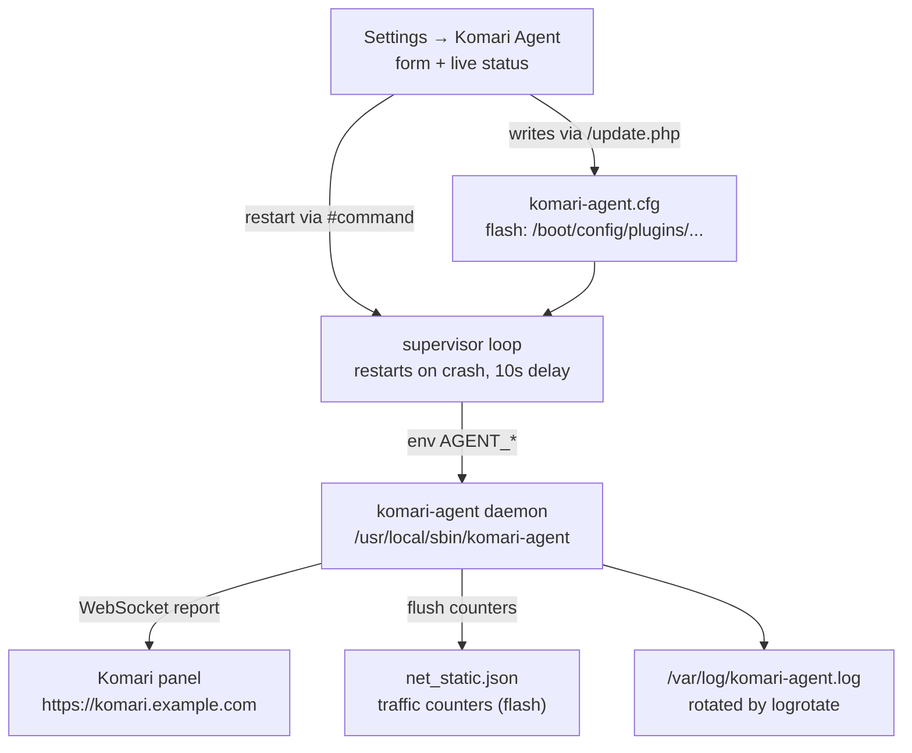
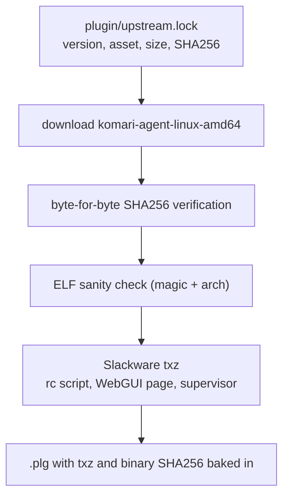

# unraid-plugin-komari-agent

**English** | [简体中文](README.zh-CN.md)

[](https://github.com/zhz8888/unraid-plugin-komari-agent/actions/workflows/build.yml)
[](LICENSE)
[](https://unraid.net)

**Run the Komari monitoring agent on Unraid OS as a real, managed service.**

`komari-agent` reports CPU, memory, disk, network throughput, load and uptime to a
[Komari](https://github.com/komari-monitor/komari) status panel over a WebSocket
connection. Upstream ships a static Go binary and documents a systemd unit.
Unraid has no systemd and nowhere to keep a daemon's state, so this project
packages the agent as a native Unraid plugin (`.plg`) with an rc script, a
crash-restarting supervisor, log rotation and a Settings page.

---

## The problem

`komari-agent` is a **long-running daemon**, not a CLI tool. On a generic Linux
host it is trivial to deploy because systemd does the hard part:

```bash
# what a systemd host does for you — none of this exists on Unraid
systemctl enable --now komari-agent
```

Unraid has none of the pieces that a daemon relies on:

| What a daemon needs | Unraid |
|---|---|
| A service manager | **none** — no systemd, no OpenRC, no runit |
| A persistent place to install to | `/usr` is a read-only squashfs with a RAM overlay; **reset on every boot** |
| A writable, persistent working directory | only the flash device (`/boot`, vfat) survives |
| Log rotation | `logrotate` is present, but nothing configures it for a new daemon |
| A crash restart | nothing — a plain `nohup` leaves a dead agent behind |
| A configuration surface | none — no WebGUI page, no saved settings |

Dropped on Unraid, the upstream binary either fails outright or leaves an
unmanaged process that dies at the first OOM and never comes back — silently,
because the panel simply shows the host as offline.

This plugin bridges that gap.

## What it does



The plugin provides the five things Unraid lacks:

1. **An rc script** at `/etc/rc.d/rc.komari-agent` (`start|stop|restart|status`),
   so the agent starts on boot and stops cleanly on shutdown.
2. **A supervisor loop** that restarts the agent when it crashes. Unraid has no
   systemd `Restart=always`, so `scripts/supervise.sh` does it with a shell loop.
3. **A flash-resident binary cache.** The executable is installed to
   `/usr/local/sbin/komari-agent` (an overlay path, wiped on reboot) and
   re-copied from the flash cache on every boot.
4. **Log rotation** at `/etc/logrotate.d/komari-agent`, because
   `/var/log/komari-agent.log` lives on a 128 MB tmpfs. It rotates at 2 MB and
   keeps two compressed generations. `copytruncate` is required: the agent holds
   the file open through its stdout redirect and never reopens it on a signal, so
   the file has to be truncated in place rather than renamed.
5. **A Settings page** that edits the configuration, restarts the agent and
   reports live status — including a panel connectivity probe.

## Install

### From a release

```bash
# on your Unraid host
cd /boot/config/plugins
wget -O unraid-plugin-komari-agent.plg \
  https://github.com/zhz8888/unraid-plugin-komari-agent/releases/latest/download/unraid-plugin-komari-agent.plg
plugin install /boot/config/plugins/unraid-plugin-komari-agent.plg
```

Or install it from **Plugins → Install Plugin** in the Unraid web UI using the
same `.plg` URL.

### Through the gh-proxy.org mirror (mainland China)

If your network cannot reach GitHub, use the mirrored plugin file. The only
difference is the download URL: `https://gh-proxy.org/` is prepended to the
GitHub release URL. The plugin package itself is byte for byte the same file,
with the same SHA256.

```bash
# on your Unraid host
cd /boot/config/plugins
wget -O unraid-plugin-komari-agent-proxy.plg \
  https://gh-proxy.org/https://github.com/zhz8888/unraid-plugin-komari-agent/releases/latest/download/unraid-plugin-komari-agent-proxy.plg
plugin install /boot/config/plugins/unraid-plugin-komari-agent-proxy.plg
```

The same prefix works for any GitHub release URL, not just this one:

```
https://gh-proxy.org/https://github.com/<owner>/<repo>/releases/download/<tag>/<file>
```

> **Install one of the two files, not both.**
> The Unraid installer registers one symlink per `.plg` *file name*, so two
> files would show up as two separate entries in the Plugins tab, and the boot
> script would install the same package twice. If both end up in
> `/boot/config/plugins/`, the canonical one removes the mirrored one on the
> next boot — the same way the official Tailscale plugin removes its preview
> build.

### Then configure it

The agent does nothing until it is pointed at a panel. Either open
**Settings → Komari Agent** in the Unraid web UI, or edit
`/boot/config/plugins/unraid-plugin-komari-agent/komari-agent.cfg` and restart:

```ini
ENDPOINT="https://komari.example.com"
TOKEN="your-agent-token"
INTERVAL="3"
```

```bash
/etc/rc.d/rc.komari-agent restart
```

The host appears in the panel within a few seconds. If it does not, see
[Troubleshooting](#troubleshooting).

## Configuration

All settings live in one file,
`/boot/config/plugins/unraid-plugin-komari-agent/komari-agent.cfg`. It is an INI
file with **no sections**, written by the Settings page through Unraid's
`/update.php`. Every value is a double-quoted string; a missing key falls back to
the default.

The agent itself is configured through **environment variables** (`AGENT_*`), not
command line arguments. That is deliberate: the token is a credential, and
anything on a command line is readable by every local user through `/proc`.

| Key | Default | Meaning | Agent variable |
|---|---|---|---|
| `ENABLED` | `1` | Start the agent at boot and on install | local switch |
| `ENDPOINT` | *(empty)* | Komari panel URL, e.g. `https://komari.example.com` | `AGENT_ENDPOINT` |
| `TOKEN` | *(empty)* | Agent token from the panel | `AGENT_TOKEN` |
| `INTERVAL` | `3` | Collection interval in seconds | `AGENT_INTERVAL` |
| `DISABLE_AUTO_UPDATE` | `1` | Disable the agent's built-in updater — see [Why auto-update is off](#why-auto-update-is-off) | `AGENT_DISABLE_AUTO_UPDATE` |
| `DISABLE_WEB_SSH` | `1` | Disable panel-issued remote control (Web SSH and RCE) | `AGENT_DISABLE_WEB_SSH` |
| `IGNORE_UNSAFE_CERT` | `0` | Accept invalid TLS certificates from the panel | `AGENT_IGNORE_UNSAFE_CERT` |
| `INCLUDE_NICS` | *(empty)* | Only count these interfaces, comma separated, wildcards allowed | `AGENT_INCLUDE_NICS` |
| `EXCLUDE_NICS` | *(empty)* | Exclude these interfaces, comma separated | `AGENT_EXCLUDE_NICS` |
| `INCLUDE_MOUNTPOINTS` | *(empty)* | Only count these mount points, **semicolon** separated | `AGENT_INCLUDE_MOUNTPOINTS` |
| `MONTH_ROTATE` | `0` | Day of the month to reset traffic counters, `0` disables | `AGENT_MONTH_ROTATE` |
| `MEMORY_INCLUDE_CACHE` | `1` | Count cache/buffer as used memory | `AGENT_MEMORY_INCLUDE_CACHE` |
| `MEMORY_REPORT_RAW_USED` | `0` | Report raw used memory instead of available-based | `AGENT_MEMORY_REPORT_RAW_USED` |
| `ENABLE_GPU` | `0` | Detailed GPU monitoring | `AGENT_ENABLE_GPU` |
| `CUSTOM_DNS` | *(empty)* | Custom DNS server for panel resolution | `AGENT_CUSTOM_DNS` |
| `PREFER_IP_VERSION` | *(empty)* | `4`, `6` or empty for automatic | `AGENT_PREFER_IP_VERSION` |
| `EXTRA_ARGS` | *(empty)* | Extra command line arguments (advanced) | appended to argv |

The defaults are chosen to be safe rather than convenient:
`DISABLE_AUTO_UPDATE=1` and `DISABLE_WEB_SSH=1` are **on** out of the box. See
[Security](#security).

Only the keys in this table are written to the configuration file. A key that no
code reads is a bug, not a feature.

## Security

Three decisions are worth stating explicitly, because they change what a
compromised panel can do to your server.

### Remote control is off by default

`komari-agent` can accept panel-issued commands: an interactive shell (Web SSH)
and arbitrary command execution (RCE). That is a remote-administration backdoor
by design, and it is a reasonable feature for a VPS you own. It is a poor default
for a NAS that also holds your family photos and your backups.

`DISABLE_WEB_SSH=1` therefore ships as the default. Enabling it on the Settings
page shows a warning; only do it if the panel is fully trusted and reachable
over TLS.

### Why auto-update is off

`komari-agent` checks GitHub Releases every six hours and **overwrites its own
executable in place**. In this plugin that behaviour is actively harmful:

1. `/usr/local/sbin` is on the overlay filesystem, so a self-updated binary is
   erased on the next reboot. Every boot re-copies the version pinned in the
   package — the downloaded update is simply thrown away.
2. It bypasses the plugin's pinned SHA256 and its reproducible build, so what
   runs on the host stops matching what the plugin was verified to install.
3. If the binary were ever placed on the flash device instead, vfat cannot store
   the executable bit, so the update would fail and retry forever.

`DISABLE_AUTO_UPDATE=1` is therefore the default. Upgrades arrive as a new
plugin release; the build pins a new upstream version in one line. The Settings
page lets you turn it back on under "Advanced", with a warning.

### The token is a credential

The agent token authenticates the host to the panel. Treat it like a password:

- it is passed to the agent **only** through the environment, never on a command
  line, so it does not appear in `ps` or `/proc/<pid>/cmdline`;
- it is stored in `/boot/config/plugins/unraid-plugin-komari-agent/komari-agent.cfg`
  on the flash device. Flash is readable by root only on a healthy Unraid
  install, but it is **not encrypted** — it is a USB stick you can pull out;
- if the token leaks, revoke it in the panel and paste the new one into the
  Settings page. Restarting the agent picks it up. No reinstall is needed.

## Uninstall

**Plugins → Uninstall** in the web UI, or:

```bash
plugin remove unraid-plugin-komari-agent.plg
```

The uninstall script stops the agent and the supervisor, removes the Slackware
package, the binary, the rc script, the logrotate configuration and the WebGUI
directory.

It deliberately **keeps** your data:

- `komari-agent.cfg` — your settings, including the token;
- `net_static.json` — the traffic counters.

Both live under `/boot/config/plugins/unraid-plugin-komari-agent/`. Delete that
directory by hand if you want a clean slate.

## Troubleshooting

Start with the Settings page: it reports whether the supervisor and the agent are
running, the agent version, uptime, the tail of the log and whether the panel is
reachable.

| Symptom | Cause | Fix |
|---|---|---|
| Host shows as offline in the panel | `ENDPOINT` or `TOKEN` empty, or wrong | Fill both in on the Settings page, save, apply |
| Settings page says "not running" | `ENABLED=0`, or the binary is missing | Set `ENABLED=1`; if the binary is missing, reinstall the plugin |
| Agent restarts every few seconds | Wrong token, or panel unreachable | Check `/var/log/komari-agent.log`; the supervisor waits 10 s between restarts |
| `certificate signed by unknown authority` | Panel uses a self-signed certificate | Install a valid certificate, or set `IGNORE_UNSAFE_CERT=1` knowingly |
| Traffic counters reset on reboot | `net_static.json` missing, or the agent was not started from the flash directory | The supervisor sets the working directory; do not start the binary by hand |
| Plugin gone from the Plugins tab | The install script exited non-zero, so Unraid moved the `.plg` to `/boot/config/plugins-error/` | Report it — this is a bug in the plugin, not in your setup |
| Everything looks fine but no data arrives | Panel URL is wrong, or DNS resolution fails on the host | Set `CUSTOM_DNS`, or check from the host: `curl -v https://komari.example.com` |

Useful commands on the host:

```bash
/etc/rc.d/rc.komari-agent status          # supervisor and agent PIDs
tail -f /var/log/komari-agent.log         # live log
cat /boot/config/plugins/unraid-plugin-komari-agent/komari-agent.cfg
ps -ef | grep komari-agent
```

## Build from source

No Go toolchain is required — this repo never compiles upstream code.

Requirements: Bash 4+, `curl`, `tar`, Python 3. (On Windows, `python3` may resolve
to a non-functional WindowsApps stub; pass `PYTHON=D:/Python312/python.exe`.)

```bash
git clone https://github.com/zhz8888/unraid-plugin-komari-agent.git
cd unraid-plugin-komari-agent

make build     # download -> verify SHA256 -> assemble txz -> render .plg
make lint      # static checks on the .plg and the WebGUI sources
make verify    # hash and layout verification

ls dist/
# unraid-plugin-komari-agent-20261106-x86_64-1.txz   <- Slackware package
# unraid-plugin-komari-agent.plg                     <- Unraid plugin definition
# unraid-plugin-komari-agent-proxy.plg               <- mirrored variant
```

Override the bundled version or architecture:

```bash
KOMARI_VERSION=1.5.10      make build   # a different upstream release
KOMARI_ARCH=arm64          make build   # a different architecture
PLUGIN_VERSION=20261106    make build   # pin the plugin version
```

`KOMARI_VERSION` has to match the version pinned in `plugin/upstream.lock`; a
mismatch fails the build with an instruction to run
`./scripts/update-upstream.sh <version>` first. That is deliberate — it keeps a
single source of truth for which upstream bytes get bundled.

Available targets: `build`, `lint`, `verify`, `smoke`, `fetch`, `upstream`,
`icon`, `clean`, `distclean`, `release`, `help`. `make smoke` unpacks the built
package and exercises the shell scripts under a fake root; it needs a build
first. `make release` runs the checks and prints the `gh release create` command
for the current build.

The build is **reproducible**: the txz is written by Python's `tarfile` with every
header field set explicitly (uid/gid 0, empty uname/gname, fixed mtime, sorted
members), so the same plugin version and upstream version produce the same txz
SHA256 on any machine and from any checkout location. CI enforces this by
building twice and comparing hashes.

### Version scheme

Two versions are tracked independently:

| Version | Format | Meaning |
|---|---|---|
| Plugin version | `YYYYMMDD` | This plugin's own release version: the release date. |
| Upstream version | `1.5.11` | The bundled `komari-agent` release. Recorded in `plugin.info`, the WebGUI page and the `.plg`'s `upstream` entity. |

When more than one release happens on the same day, the later ones carry a
letter suffix:

```
20261106      the first release of that day
20261106.a    the second release of that day
20261106.b    the third release of that day
20261107      the next day
```

The Unraid installer compares plugin versions with `strcmp()`, a byte-wise
string compare, so the format has to sort in release order. This one does
(`20261106 < 20261106.a < 20261106.b < 20261107`). A semantic version does not:
`1.5.10` sorts *below* `1.5.9` because the byte `1` is less than `9`, so Unraid
would judge the newer release to be older and refuse the upgrade.

The plugin version is deliberately **not** tied to the upstream version: a
repackaging of the same upstream release — a fixed install script, a new Settings
page — still has to reach the users who installed an earlier package.

## How the binary is sourced

This project redistributes the `komari-agent` binary **unmodified** from the
official GitHub Release.



The exact upstream asset is pinned in `plugin/upstream.lock`: version, asset name,
byte size, URL and SHA256. The build reads that file, downloads the asset and
verifies the bytes against the recorded digest. It never queries the GitHub API,
which keeps the build reproducible, offline capable and independent of API rate
limits. Moving to a new upstream release is `scripts/update-upstream.sh <version>`
followed by a reviewed diff of the lock file, so an upstream bump is visible in
the pull request instead of happening invisibly during CI.

The recorded digest is the value GitHub publishes in the `digest` field of the
release asset, which GitHub computes from the uploaded bytes.

The binary is a static Go executable (`CGO_ENABLED=0`), so it needs no runtime
dependencies on Unraid.

Why not build from source? Because the release asset **is** the official
artifact, and rebuilding it would produce a binary that no upstream checksum can
be compared against. See [`docs/01-design-decisions.md`](docs/01-design-decisions.md)
for the full evaluation.

## Compatibility

| | Requirement |
|---|---|
| Unraid | 7.0+ |
| Architecture | x86_64 only (Unraid ships no other architecture) |
| Free flash space | ~35 MB (12 MB binary cache + txz) |
| Panel | Any Komari version that accepts agent `1.5.11` |
| Network | Outbound HTTPS/WSS to the panel |

Other architectures (`386`, `arm`, `arm64`, `loong64`) are supported by the build
script through `KOMARI_ARCH`, but are not published, because Unraid itself is
x86_64-only.

## Known limitations

1. **Nothing installed under `/usr` survives a reboot.** Unraid mounts `/usr` as
   a read-only squashfs with a RAM overlay, and `/var/log` — where the plugin
   manager keeps the "installed" registry — is a tmpfs. Every boot therefore
   re-runs the plugin's install script, which restores the binary from the copy
   cached on the flash device. This is also why the install script must be
   idempotent and must never exit non-zero: a non-zero exit makes the installer
   move the `.plg` to `/boot/config/plugins-error/`, which leaves the plugin
   unregistered and without an Uninstall button.
2. **The working directory is the flash directory.** The agent writes its
   traffic counters to `./net_static.json`, so the supervisor `cd`s to
   `/boot/config/plugins/unraid-plugin-komari-agent/` before every start (and
   falls back to `/var/tmp`, with a log line, if that directory cannot be
   entered). That costs one small file write (roughly 100–200 KB) to the USB
   stick every ten minutes. It is the only way to keep the counters across
   reboots, because flash is the only persistent writable location on Unraid.
3. **`/var/log` is a 128 MB tmpfs.** Logs do not survive a reboot. That is
   usually what you want for a monitoring agent, and logrotate keeps the size
   bounded.
4. **The supervisor is a shell loop, not systemd.** It restarts the agent after a
   crash with a 10-second delay, but it does not do exponential backoff, resource
   limits or cgroup accounting. Unraid provides no mechanism for those.
5. **Unraid has no `systemctl`.** Manage the agent with
   `/etc/rc.d/rc.komari-agent {start|stop|restart|status}` or the Settings page.
6. **The plugin does not create a Komari panel.** You need an existing panel and
   a token issued by it.

## Conformance with the official Unraid plugin rules

The plugin follows the conventions of the plugins Lime Technology maintains
(`unraid/unraid-tailscale`, `unraid/apprise-plugin`,
`unraid/unraid-nvidia-driver`):

- date based plugin version, because the installer compares plugin versions
  with `strcmp()`;
- a Slackware package installed with `upgradepkg` and removed with `removepkg`;
- the WebGUI page under `/usr/local/emhttp/plugins/<name>/`, with the `launch`
  and `icon` attributes pointing at it;
- `<SHA256>` on every downloaded file, and a version in the cached file name;
- an idempotent install script that never exits non-zero;
- a `remove` script that cleans up the package but keeps user data.

[`docs/05-unraid-plugin-conventions.md`](docs/05-unraid-plugin-conventions.md)
maps every rule to the code that implements it, and lists the points that still
need verification on a real Unraid host.

## Naming conventions

| Where | Name | Note |
|---|---|---|
| Repo | `unraid-plugin-komari-agent` | this project |
| Unraid plugin | `unraid-plugin-komari-agent` | `<PLUGIN name="...">` |
| `.plg` file | `unraid-plugin-komari-agent.plg` | goes in `/boot/config/plugins/` |
| Mirrored `.plg` | `unraid-plugin-komari-agent-proxy.plg` | install this one **or** the canonical one, never both |
| Flash config dir | `/boot/config/plugins/unraid-plugin-komari-agent/` | holds the config, the binary cache and `net_static.json` |
| Slackware package | `unraid-plugin-komari-agent-<plugin-version>-x86_64-1.txz` | installed by `upgradepkg` |
| Installed binary | `/usr/local/sbin/komari-agent` | **fixed name**, the upstream binary name |
| rc script | `/etc/rc.d/rc.komari-agent` | `start\|stop\|restart\|status` |
| Supervisor script | `/usr/local/emhttp/plugins/unraid-plugin-komari-agent/scripts/supervise.sh` | started by `start.sh` |
| WebGUI page | `/usr/local/emhttp/plugins/unraid-plugin-komari-agent/KomariAgent.page` | target of the `launch` attribute |
| Log | `/var/log/komari-agent.log` | tmpfs, rotated |
| pidfile | `/var/run/komari-agent.pid` | holds the **supervisor** pid |

## Repository layout

```
.
├── README.md                              # this file
├── README.zh-CN.md                        # Chinese README
├── CHANGELOG.md
├── CONTRIBUTING.md
├── SECURITY.md
├── LICENSE                                # MIT (this project)
├── NOTICE                                 # MIT attribution for the bundled agent
├── icon.svg                               # repository icon, used by Community Applications
├── ca_profile.xml                         # Community Applications repository profile
├── Makefile                               # build / lint / verify convenience targets
├── ca/
│   └── unraid-plugin-komari-agent.xml     # Community Applications entry for this plugin
├── docs/
│   ├── README.md                          # docs index
│   ├── 01-design-decisions.md             # why the official binary, not a source build
│   ├── 02-technical-design.md             # daemon supervision, install/uninstall flow
│   └── 05-unraid-plugin-conventions.md    # mapping to the official plugin rules
├── plugin/
│   ├── unraid-plugin-komari-agent.plg.in  # Unraid plugin template
│   ├── upstream.lock                      # pinned upstream version, asset and SHA256
│   ├── install.sh                         # install script fragment (spliced into the .plg)
│   └── remove.sh                          # uninstall script fragment
├── src/                                   # Slackware package source tree
│   ├── install/
│   │   ├── slack-desc                     # package description
│   │   └── doinst.sh                      # post-install hook
│   ├── etc/
│   │   ├── rc.d/rc.komari-agent           # service script
│   │   └── logrotate.d/komari-agent       # log rotation
│   └── usr/local/
│       └── emhttp/plugins/unraid-plugin-komari-agent/
│           ├── KomariAgent.page           # landing tab (summary), target of `launch`
│           ├── KomariAgent-1-Settings.page # configuration form
│           ├── KomariAgent-2-Status.page   # detail tab: binary, traffic, log tail
│           ├── README.md                  # description for the Plugins tab
│           ├── plugin.info                # build metadata (generated)
│           ├── unraid-plugin-komari-agent.png
│           ├── include/
│           │   ├── common.php
│           │   ├── Pages/{Settings,Status}.php
│           │   └── data/{Status,Action}.php
│           └── scripts/
│               ├── lib.sh                 # shared helpers for the scripts below
│               ├── start.sh  supervise.sh  stop.sh
│               ├── restart.sh  status.sh  clear-traffic.sh
│               └── apply.sh
├── scripts/
│   ├── build-plugin.sh                    # build: download -> verify -> txz -> plg
│   ├── fetch-plugin.sh                    # download + verify only (audit)
│   ├── update-upstream.sh                 # refresh plugin/upstream.lock
│   ├── lint-plg.sh                        # static checks on the generated .plg
│   ├── check-php-syntax.py                # syntax check on the WebGUI sources
│   ├── smoke-test.sh                      # run the packaged scripts under a fake root
│   ├── make-icon.py                       # regenerate the plugin icon
│   └── verify-release.sh                  # verify hashes and layout
└── .github/
    ├── workflows/build.yml                # CI: build, lint, verify, reproducibility
    ├── workflows/upstream-check.yml       # daily upstream version check
    ├── ISSUE_TEMPLATE/
    └── pull_request_template.md
```

## Documentation

Deep-dive documents live in [`docs/`](docs/README.md). They are written in
Chinese; the code, scripts and this README are in English.

- [Design decisions](docs/01-design-decisions.md) — why the official release asset, not a source build
- [Technical design](docs/02-technical-design.md) — daemon supervision, install/uninstall flow, why the working directory is flash
- [Unraid plugin conventions](docs/05-unraid-plugin-conventions.md) — how this plugin maps to the official plugin rules

## Contributing

See [CONTRIBUTING.md](CONTRIBUTING.md). Before opening a PR:

```bash
make build && make lint && make verify
```

Bugs in `komari-agent` itself — the WebSocket protocol, metric collection, the
panel API — belong upstream at
[komari-monitor/komari-agent](https://github.com/komari-monitor/komari-agent/issues).
This repo only packages that binary for Unraid.

## License

- This project's scripts and documentation: **MIT** — see [LICENSE](LICENSE).
- The bundled `komari-agent` binary: **MIT**, © komari-monitor,
  redistributed unmodified — see [NOTICE](NOTICE).

The Komari panel is not distributed by this project; you run your own.
