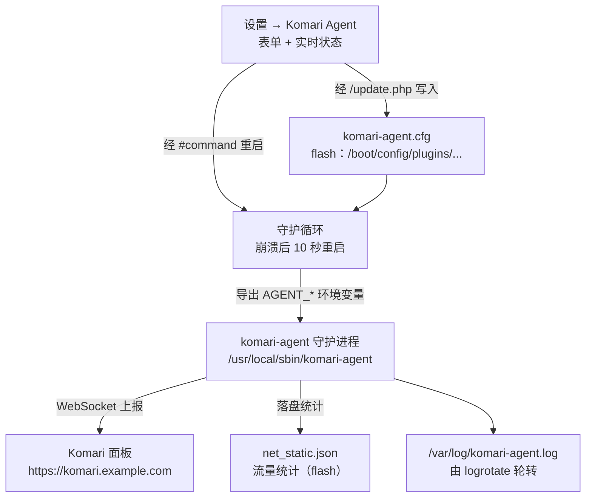
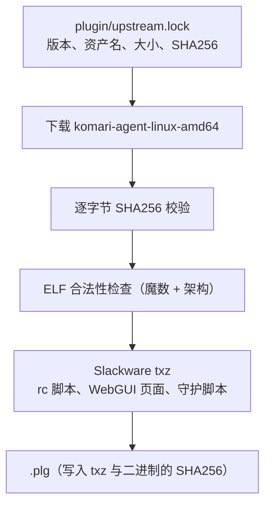

# unraid-plugin-komari-agent

[English](README.md) | **简体中文**

[](https://github.com/zhz8888/unraid-plugin-komari-agent/actions/workflows/build.yml)
[](LICENSE)

**把 Komari 监控 agent 以真正被托管的服务形式跑在 Unraid OS 上。**

`komari-agent` 通过 WebSocket 向 [Komari](https://github.com/komari-monitor/komari)
状态面板上报 CPU、内存、磁盘、网络流量、负载和在线状态。上游提供的是静态 Go 二进制
和一份 systemd 单元文件；Unraid 既没有 systemd，也没有能存守护进程状态的地方，所以
本项目把它打包成原生 Unraid 插件（`.plg`），自带 rc 脚本、崩溃重启守护、日志轮转和
设置页面。

---

## 问题背景

`komari-agent` 是**常驻守护进程**，不是一次性 CLI 工具。在普通 Linux 主机上部署它
只需要一条命令，因为 systemd 把难的部分做完了：

```bash
# systemd 主机上替你完成的事——Unraid 上这些全都没有
systemctl enable --now komari-agent
```

而 Unraid 缺少守护进程赖以生存的全部基础设施：

| 守护进程需要什么 | Unraid 的现状 |
|---|---|
| 服务管理器 | **没有** —— 无 systemd、无 OpenRC、无 runit |
| 可持久安装的位置 | `/usr` 是「只读 squashfs + 内存 overlay」，**每次开机重置** |
| 可写且持久的工作目录 | 只有 flash（`/boot`，vfat）能跨重启保留 |
| 日志轮转 | `logrotate` 存在，但没有任何东西为新守护进程配置它 |
| 崩溃重启 | 没有 —— 裸 `nohup` 之后进程死了就是死了 |
| 配置界面 | 没有 —— 既无 WebGUI 页面，也无持久化设置 |

把上游二进制直接丢到 Unraid 上，要么直接跑不起来，要么留下一个无人管理的进程：
第一次 OOM 就死掉，然后再也不回来——而且面板上只会显示这台主机离线，不会有任何提示。

本插件补齐这个缺口。

## 它做了什么



插件补上了 Unraid 缺的五件事：

1. **rc 脚本** `/etc/rc.d/rc.komari-agent`（`start|stop|restart|status`），
   开机自启、关机优雅停止。
2. **守护循环**：agent 崩溃时自动拉起。Unraid 没有 systemd 的 `Restart=always`，
   所以由 `scripts/supervise.sh` 用一个 shell 循环实现。
3. **flash 上的二进制缓存**：可执行文件装到 `/usr/local/sbin/komari-agent`
   （overlay 路径，重启即丢），每次开机从 flash 缓存重新拷入。
4. **日志轮转** `/etc/logrotate.d/komari-agent`，因为
   `/var/log/komari-agent.log` 位于 128MB 的 tmpfs 上。2MB 轮转一次，保留两代压缩
   归档。必须用 `copytruncate`：agent 通过 stdout 重定向一直持有该文件句柄，收到信号
   时不会重新打开，所以只能就地截断而不能重命名。
5. **设置页面**：编辑配置、重启 agent、查看实时状态（含面板连通性探测）。

## 安装

### 从 Release 安装

```bash
# 在 Unraid 主机上执行
cd /boot/config/plugins
wget -O unraid-plugin-komari-agent.plg \
  https://github.com/zhz8888/unraid-plugin-komari-agent/releases/latest/download/unraid-plugin-komari-agent.plg
plugin install /boot/config/plugins/unraid-plugin-komari-agent.plg
```

也可以在 Unraid Web UI 的 **Plugins → Install Plugin** 里填同一个 `.plg` URL。

### 通过 gh-proxy.org 代理安装（中国大陆）

如果你的网络无法直连 GitHub，可以使用**代理版**插件文件。两者唯一的区别是下载
地址——在 GitHub 链接前拼接 `https://gh-proxy.org/` 即可。插件包本身是同一个文件，
逐字节一致，SHA256 也相同。

```bash
# 在 Unraid 主机上执行
cd /boot/config/plugins
wget -O unraid-plugin-komari-agent-proxy.plg \
  https://gh-proxy.org/https://github.com/zhz8888/unraid-plugin-komari-agent/releases/latest/download/unraid-plugin-komari-agent-proxy.plg
plugin install /boot/config/plugins/unraid-plugin-komari-agent-proxy.plg
```

同样的前缀适用于任意 GitHub Release 链接，不限于本项目：

```
https://gh-proxy.org/https://github.com/<owner>/<repo>/releases/download/<tag>/<file>
```

> **两个文件只需安装其中一个。**
> Unraid 安装器按 `.plg` 的**文件名**建立软链，两个文件同时存在会在 Plugins 页
> 显示成两条记录，而且开机脚本会把同一个包装两遍。如果两个都放进了
> `/boot/config/plugins/`，主版会在下次开机时删掉代理版——这与官方 Tailscale
> 插件清理 preview 分支的做法一致。

### 然后配置它

没指向面板之前 agent 什么也不做。打开 Web UI 的 **设置 → Komari Agent**，或者直接
编辑 `/boot/config/plugins/unraid-plugin-komari-agent/komari-agent.cfg` 后重启：

```ini
ENDPOINT="https://komari.example.com"
TOKEN="your-agent-token"
INTERVAL="3"
```

```bash
/etc/rc.d/rc.komari-agent restart
```

几秒内主机就会出现在面板里。如果没有，见[故障排查](#故障排查)。

## 配置说明

所有设置集中在一个文件：
`/boot/config/plugins/unraid-plugin-komari-agent/komari-agent.cfg`。它是**无分节**的
INI 文件，由设置页面经 Unraid 的 `/update.php` 写入。所有值都是双引号字符串，缺失的
键回退到默认值。

agent 本身通过**环境变量**（`AGENT_*`）配置，而不是命令行参数。这是刻意的：token 是
凭据，而命令行上的任何内容本机任何用户都能通过 `/proc` 读到。

| 键 | 默认值 | 说明 | agent 变量 |
|---|---|---|---|
| `ENABLED` | `1` | 开机/安装时是否自动启动 | 本地开关 |
| `ENDPOINT` | *（空）* | Komari 面板地址，如 `https://komari.example.com` | `AGENT_ENDPOINT` |
| `TOKEN` | *（空）* | 面板签发的 agent token | `AGENT_TOKEN` |
| `INTERVAL` | `3` | 采集间隔（秒） | `AGENT_INTERVAL` |
| `DISABLE_AUTO_UPDATE` | `1` | 关闭 agent 内置自更新——原因见[为什么关闭自更新](#为什么关闭自更新) | `AGENT_DISABLE_AUTO_UPDATE` |
| `DISABLE_WEB_SSH` | `1` | 关闭面板下发的远程控制（Web SSH 与 RCE） | `AGENT_DISABLE_WEB_SSH` |
| `IGNORE_UNSAFE_CERT` | `0` | 接受面板的无效 TLS 证书 | `AGENT_IGNORE_UNSAFE_CERT` |
| `INCLUDE_NICS` | *（空）* | 仅统计这些网卡，逗号分隔，支持通配符 | `AGENT_INCLUDE_NICS` |
| `EXCLUDE_NICS` | *（空）* | 排除这些网卡，逗号分隔 | `AGENT_EXCLUDE_NICS` |
| `INCLUDE_MOUNTPOINTS` | *（空）* | 仅统计这些挂载点，**分号**分隔 | `AGENT_INCLUDE_MOUNTPOINTS` |
| `MONTH_ROTATE` | `0` | 流量统计每月重置日，`0` 为禁用 | `AGENT_MONTH_ROTATE` |
| `MEMORY_INCLUDE_CACHE` | `1` | 内存统计含 cache/buffer | `AGENT_MEMORY_INCLUDE_CACHE` |
| `MEMORY_REPORT_RAW_USED` | `0` | 用 raw used 口径上报内存 | `AGENT_MEMORY_REPORT_RAW_USED` |
| `ENABLE_GPU` | `0` | 详细 GPU 监控 | `AGENT_ENABLE_GPU` |
| `CUSTOM_DNS` | *（空）* | 面板域名解析使用的自定义 DNS | `AGENT_CUSTOM_DNS` |
| `PREFER_IP_VERSION` | *（空）* | `4`、`6` 或空（自动） | `AGENT_PREFER_IP_VERSION` |
| `EXTRA_ARGS` | *（空）* | 追加命令行参数（高级） | 直接拼到 argv |

默认值取向是**安全优先而非方便优先**：`DISABLE_AUTO_UPDATE=1` 和
`DISABLE_WEB_SSH=1` 出厂即开。见[安全说明](#安全说明)。

只有上表中的键会被写入配置文件。声明了却没有代码读取的键是 bug，不是特性。

## 安全说明

有三个决策值得明说，因为它们决定了「面板被攻破时，你的服务器还能被怎样」。

### 远程控制默认关闭

`komari-agent` 可以接受面板下发的命令：交互式 shell（Web SSH）和任意命令执行
（RCE）。这本质上就是一个远程管理后门——对于你自己拥有的 VPS，这是合理功能；但对于
一台同时存放家庭照片和备份的 NAS，这是个糟糕的默认值。

因此 `DISABLE_WEB_SSH=1` 出厂即默认。在设置页打开它会弹出警告；只有当你完全信任
面板、并且面板走 TLS 时才应该开启。

### 为什么关闭自更新

`komari-agent` 每 6 小时查询一次 GitHub Releases，并**原地覆盖自己的可执行文件**。
在本插件里这个行为是有害的：

1. `/usr/local/sbin` 在 overlay 上，自更新得到的二进制重启即被抹掉。每次开机都会从
   包内钉死的版本重新拷贝——下载来的更新被直接丢弃。
2. 它绕过了插件钉死的 SHA256 和可复现构建，导致主机上实际运行的二进制与插件被验证
   过的内容不再一致。
3. 若把二进制改放到 flash 上，vfat 无法保存执行位，自更新必然失败并无限重试。

因此默认 `DISABLE_AUTO_UPDATE=1`。版本升级通过发布新插件完成，构建脚本只改一行 pin。
设置页在「高级」区域允许用户显式打开，并给出警告。

### token 是凭据

agent token 用于让面板认证这台主机。请像对待密码一样对待它：

- token 只通过**环境变量**传给 agent，绝不进入命令行，因此不会出现在 `ps` 或
  `/proc/<pid>/cmdline` 里；
- 它保存在 flash 上的
  `/boot/config/plugins/unraid-plugin-komari-agent/komari-agent.cfg`。健康的 Unraid
  安装中 flash 只有 root 可读，但它**没有加密**——那是一根你能直接拔走的 U 盘；
- token 泄露时，在面板里吊销它，把新的填进设置页面并重启 agent 即可，无需重装。

## 卸载

Web UI 的 **Plugins → Uninstall**，或：

```bash
plugin remove unraid-plugin-komari-agent.plg
```

卸载脚本会停止 agent 与守护循环，移除 Slackware 包、二进制、rc 脚本、日志轮转配置和
WebGUI 目录。

它**刻意保留**你的数据：

- `komari-agent.cfg` —— 你的设置，含 token；
- `net_static.json` —— 流量统计。

两者都在 `/boot/config/plugins/unraid-plugin-komari-agent/` 下。想要彻底清干净，手动
删掉这个目录即可。

## 故障排查

先看设置页面：它会报告守护循环与 agent 是否在运行、agent 版本、运行时长、日志尾部，
以及面板是否可达。

| 现象 | 原因 | 处理 |
|---|---|---|
| 面板里显示主机离线 | `ENDPOINT` 或 `TOKEN` 为空或写错 | 在设置页填好两者，保存并应用 |
| 设置页显示「未运行」 | `ENABLED=0`，或二进制缺失 | 置 `ENABLED=1`；二进制缺失则重装插件 |
| agent 每隔几秒重启一次 | token 错误，或面板不可达 | 查看 `/var/log/komari-agent.log`；守护循环每次重启间隔 10 秒 |
| `certificate signed by unknown authority` | 面板使用自签证书 | 换成有效证书，或在知情前提下设 `IGNORE_UNSAFE_CERT=1` |
| 重启后流量统计归零 | `net_static.json` 缺失，或 agent 不是从 flash 目录启动的 | 守护循环会设置工作目录；不要手工直接运行二进制 |
| 插件从 Plugins 页消失了 | 安装脚本非零退出，Unraid 把 `.plg` 移到了 `/boot/config/plugins-error/` | 请报 issue——这是插件的 bug，不是你的配置问题 |
| 一切正常但没有数据 | 面板 URL 写错，或主机 DNS 解析失败 | 设置 `CUSTOM_DNS`，或在主机上验证：`curl -v https://komari.example.com` |

主机上常用的命令：

```bash
/etc/rc.d/rc.komari-agent status          # 守护循环与 agent 的 PID
tail -f /var/log/komari-agent.log         # 实时日志
cat /boot/config/plugins/unraid-plugin-komari-agent/komari-agent.cfg
ps -ef | grep komari-agent
```

## 从源码构建

不需要 Go 工具链——本仓库从不编译上游代码。

依赖：Bash 4+、`curl`、`tar`、Python 3。（Windows 上 `python3` 可能解析到不可用的
WindowsApps 存根，此时传 `PYTHON=D:/Python312/python.exe`。）

```bash
git clone https://github.com/zhz8888/unraid-plugin-komari-agent.git
cd unraid-plugin-komari-agent

make build     # 下载 -> 校验 SHA256 -> 组装 txz -> 渲染 .plg
make lint      # 对 .plg 与 WebGUI 源码做静态检查
make verify    # 校验哈希与包内结构

ls dist/
# unraid-plugin-komari-agent-20261106-x86_64-1.txz   <- Slackware 安装包
# unraid-plugin-komari-agent.plg                     <- Unraid 插件定义文件
# unraid-plugin-komari-agent-proxy.plg               <- 代理版
```

### 检查上游更新

每日的 `upstream-check` 工作流调用 `scripts/check-upstream.sh`，该脚本在本地
运行时的语义完全相同：

```bash
./scripts/check-upstream.sh              # 人类可读报告
./scripts/check-upstream.sh --json       # 机器可读
GITHUB_TOKEN=$(gh auth token) ./scripts/check-upstream.sh   # 提高 API 限流额度
```

**检查完成就返回 `0`**，无论有没有新版本——"没有新版本"本身就是一次成功的检查。
无法完成时返回 `1`，并且会区分「限流/网络失败」与「release 真的不存在」：
明明是被 403 拦住却告诉你 pin 写错了，只会让你去错的地方排查。

覆盖上游版本或架构：

```bash
KOMARI_VERSION=1.5.10      make build   # 换一个上游版本
KOMARI_ARCH=arm64          make build   # 换一个架构
PLUGIN_VERSION=20261106    make build   # 固定插件版本号
```

`KOMARI_VERSION` 必须与 `plugin/upstream.lock` 里钉的版本一致；不一致时构建会失败并
提示先运行 `./scripts/update-upstream.sh <版本>`。这是刻意的——保证"到底捆绑了哪一份
上游字节"只有一个事实来源。

可用 target：`build`、`lint`、`verify`、`smoke`、`fetch`、`upstream`、`icon`、
`clean`、`distclean`、`release`、`help`。`make smoke` 会解开构建好的包，在伪 root 下
实际跑一遍 shell 脚本；它需要先构建。`make release` 跑完检查并打印当前构建的
`gh release create` 命令。

构建是**可复现**的：txz 由 Python 的 `tarfile` 写出，每个头部字段都显式指定
（uid/gid 为 0、uname/gname 为空、mtime 固定、成员排序），因此同一「插件版本 + 上游
版本」组合在任何机器、任何检出目录都产出相同的 txz SHA256。CI 会连续构建两次并比对
hash 来强制保证这一点。

### 版本号方案

项目同时跟踪两个互不相关的版本号：

| 版本 | 格式 | 含义 |
|---|---|---|
| 插件版本 | `YYYYMMDD` | 插件自身的发布版本：发布日期。 |
| 上游版本 | `1.5.11` | 捆绑的 `komari-agent` 版本，记录在 `plugin.info`、WebGUI 页面和 `.plg` 的 `upstream` 实体里。 |

同一天发布多次时，后面的版本追加一个字母后缀：

```
20261106      当天的第一个版本
20261106.a    当天的第二个版本
20261106.b    当天的第三个版本
20261107      第二天
```

Unraid 安装器用 `strcmp()`（按字节比较字符串）比较插件版本，所以格式必须能按发布
顺序递增。这套格式可以（`20261106 < 20261106.a < 20261106.b < 20261107`）。语义化
版本不行：`1.5.10` 排在 `1.5.9` **之前**（字节 `1` 小于 `9`），Unraid 会把新版本判定
成更旧而拒绝升级。

插件版本**刻意不跟随**上游版本：同一个上游版本的重新打包——比如修了安装脚本、加了
设置页面——同样要能推给已经装过的用户。

## 二进制来源

本项目**原样**分发 GitHub Release 中的 `komari-agent` 二进制。



上游的确切资产钉在 `plugin/upstream.lock` 里：版本、资产名、字节大小、URL 与 SHA256。
构建读取该文件，下载资产后按记录的摘要逐字节校验。**构建过程从不查询 GitHub API**，
这让构建可复现、可离线、也不受 API 限流影响。升级上游版本的做法是运行
`scripts/update-upstream.sh <版本>`，然后审阅锁文件的 diff——于是上游升级会出现在
pull request 里，而不是在 CI 期间悄悄发生。

记录的摘要就是 GitHub 在 release 资产的 `digest` 字段里公布的值，由 GitHub 对上传的
字节计算得出。

该二进制是静态 Go 可执行文件（`CGO_ENABLED=0`），在 Unraid 上无运行时依赖。

为什么不从源码编译？因为 Release 资产**本身就是**官方产物，重新编译只会得到一个
无法与任何上游校验值比对的二进制。完整评估见
[`docs/01-design-decisions.md`](docs/01-design-decisions.md)。

## 兼容性

| 项目 | 要求 |
|---|---|
| Unraid | 7.0+ |
| 架构 | 仅 x86_64（Unraid 不提供其它架构） |
| flash 可用空间 | 约 35MB（12MB 二进制缓存 + txz） |
| 面板 | 任意能接受 agent `1.5.11` 的 Komari 版本 |
| 网络 | 到面板的出站 HTTPS/WSS |

其它架构（`386`、`arm`、`arm64`、`loong64`）构建脚本通过 `KOMARI_ARCH` 支持，但不
发布，因为 Unraid 本身只有 x86_64。

## 已知限制

1. **`/usr` 下的任何东西重启即丢失。** Unraid 把 `/usr` 挂成「只读 squashfs + 内存
   overlay」，而 `/var/log`（插件管理器记录「已安装」的地方）是 tmpfs。所以每次开机
   都会重跑插件的安装脚本，从 flash 上缓存的副本恢复二进制。这也是安装脚本必须
   幂等、且**绝不能以非零状态退出**的原因：非零退出会让安装器把 `.plg` 移到
   `/boot/config/plugins-error/`，插件从此没有注册记录，WebGUI 里连卸载按钮都没有。
2. **工作目录是 flash 目录。** agent 把流量统计写到 `./net_static.json`，所以守护循环
   在每轮拉起 agent 前 `cd` 到 `/boot/config/plugins/unraid-plugin-komari-agent/`
   （不可进入时退回 `/var/tmp` 并记日志）。代价是每 10 分钟一次小文件写入
   （约 100–200 KB）到 U 盘。这是唯一能让统计跨重启保留的办法，因为 flash 是 Unraid 上
   唯一可持久写入的位置。
3. **`/var/log` 是 128MB tmpfs。** 日志不跨重启。对监控 agent 来说这通常正是你想要的，
   而 logrotate 会把体积控制在有界范围内。
4. **守护循环是 shell 循环，不是 systemd。** 它会在 agent 崩溃后 10 秒重启，但没有
   指数退避、资源限制或 cgroup 记账——Unraid 不提供这些机制。
5. **Unraid 没有 `systemctl`。** 用 `/etc/rc.d/rc.komari-agent {start|stop|restart|status}`
   或设置页面来管理。
6. **本插件不创建 Komari 面板。** 你需要一个现成的面板，以及它签发的 token。

## 与 Unraid 官方插件规范的对照

本插件遵循 Lime Technology 官方维护的插件（`unraid/unraid-tailscale`、
`unraid/apprise-plugin`、`unraid/unraid-nvidia-driver`）的惯例：

- 日期式插件版本号——因为安装器用 `strcmp()` 比较插件版本；
- 用 Slackware 包安装（`upgradepkg`）、用 `removepkg` 卸载；
- WebGUI 页面放在 `/usr/local/emhttp/plugins/<name>/`，`launch` 与 `icon`
  属性指向它；
- 每个下载文件都带 `<SHA256>`，缓存文件名里含版本号；
- 安装脚本幂等，且永不以非零状态退出；
- `remove` 脚本清理包本身但保留用户数据。

[`docs/05-unraid-plugin-conventions.md`](docs/05-unraid-plugin-conventions.md)
逐条给出规范与实现的对应关系，并列出仍需在真实 Unraid 主机上验证的点。

## 命名约定

| 位置 | 名称 | 说明 |
|---|---|---|
| 仓库 | `unraid-plugin-komari-agent` | 本项目 |
| Unraid 插件 | `unraid-plugin-komari-agent` | `<PLUGIN name="...">` |
| `.plg` 文件 | `unraid-plugin-komari-agent.plg` | 放 `/boot/config/plugins/` |
| 代理版 `.plg` | `unraid-plugin-komari-agent-proxy.plg` | 与主版**二选一**安装 |
| flash 配置目录 | `/boot/config/plugins/unraid-plugin-komari-agent/` | 存放配置、二进制缓存与 `net_static.json` |
| Slackware 包 | `unraid-plugin-komari-agent-<插件版本>-x86_64-1.txz` | 由 `upgradepkg` 安装 |
| 安装的二进制 | `/usr/local/sbin/komari-agent` | **名字固定**，即上游二进制名 |
| rc 脚本 | `/etc/rc.d/rc.komari-agent` | `start\|stop\|restart\|status` |
| 守护脚本 | `/usr/local/emhttp/plugins/unraid-plugin-komari-agent/scripts/supervise.sh` | 由 `start.sh` 拉起 |
| WebGUI 页面 | `/usr/local/emhttp/plugins/unraid-plugin-komari-agent/KomariAgent.page` | `launch` 属性指向它 |
| 日志 | `/var/log/komari-agent.log` | tmpfs，已轮转 |
| pidfile | `/var/run/komari-agent.pid` | 记录**守护循环**的 pid |

## 仓库结构

```
.
├── README.md                              # 英文版 README
├── README.zh-CN.md                        # 本文件
├── CHANGELOG.md
├── CONTRIBUTING.md
├── SECURITY.md
├── LICENSE                                # MIT（本项目自身）
├── NOTICE                                 # 捆绑 agent 的 MIT 归属声明
├── icon.svg                               # 仓库图标（CA 收录用）
├── ca_profile.xml                         # CA 仓库信息
├── Makefile                               # build / lint / verify 快捷命令
├── ca/
│   └── unraid-plugin-komari-agent.xml     # CA 收录条目
├── docs/
│   ├── README.md                          # 文档索引
│   ├── 01-design-decisions.md             # 为什么用官方二进制而不是源码编译
│   ├── 02-technical-design.md             # 守护机制、安装/卸载流程
│   └── 05-unraid-plugin-conventions.md    # 与 Unraid 官方插件规范的逐条对照
├── plugin/
│   ├── unraid-plugin-komari-agent.plg.in  # Unraid 插件模板
│   ├── upstream.lock                      # 钉死的上游版本、资产名与 SHA256
│   ├── install.sh                         # 安装脚本片段（构建期拼进 .plg）
│   └── remove.sh                          # 卸载脚本片段
├── src/                                   # Slackware 包源码树
│   ├── install/
│   │   ├── slack-desc                     # 包描述
│   │   └── doinst.sh                      # 安装后钩子
│   ├── etc/
│   │   ├── rc.d/rc.komari-agent           # 服务脚本
│   │   └── logrotate.d/komari-agent       # 日志轮转
│   └── usr/local/
│       └── emhttp/plugins/unraid-plugin-komari-agent/
│           ├── KomariAgent.page           # 首页 tab（概览），`launch` 指向它
│           ├── KomariAgent-1-Settings.page # 配置表单
│           ├── KomariAgent-2-Status.page   # 详情 tab：二进制、流量、日志尾部
│           ├── README.md                  # Plugins 页的插件说明
│           ├── plugin.info                # 构建元数据（生成）
│           ├── unraid-plugin-komari-agent.png
│           ├── include/
│           │   ├── common.php
│           │   ├── Pages/{Settings,Status}.php
│           │   └── data/{Status,Action}.php
│           └── scripts/
│               ├── lib.sh                 # 下列脚本共用的助手函数
│               ├── start.sh  supervise.sh  stop.sh
│               ├── restart.sh  status.sh  clear-traffic.sh
│               └── apply.sh
├── scripts/
│   ├── build-plugin.sh                    # 构建：下载 -> 校验 -> txz -> plg
│   ├── fetch-plugin.sh                    # 仅下载 + 校验（审计用）
│   ├── update-upstream.sh                 # 刷新 plugin/upstream.lock
│   ├── lint-plg.sh                        # 对生成的 .plg 做静态检查
│   ├── check-php-syntax.py                # WebGUI 源码语法检查
│   ├── smoke-test.sh                      # 在伪 root 下实际跑一遍包内脚本
│   ├── make-icon.py                       # 重新生成插件图标
│   └── verify-release.sh                  # 校验哈希与包内结构
└── .github/
    ├── workflows/build.yml                # CI：构建、lint、verify、可复现性校验
    ├── workflows/upstream-check.yml       # 每日检查上游新版本
    ├── ISSUE_TEMPLATE/
    └── pull_request_template.md
```

## 文档

深入文档在 [`docs/`](docs/README.md)，为中文撰写；代码、脚本与本 README 为英文。

- [选型评估](docs/01-design-decisions.md) — 为什么用官方 Release 资产而不是源码编译
- [技术方案](docs/02-technical-design.md) — 守护机制、安装/卸载流程、为什么工作目录在 flash
- [官方插件规范对照](docs/05-unraid-plugin-conventions.md) — 本插件与 Unraid 官方规范的逐条映射

## 贡献

见 [CONTRIBUTING.md](CONTRIBUTING.md)。提交 PR 前请跑：

```bash
make build && make lint && make verify
```

`komari-agent` 本身的问题——WebSocket 协议、指标采集、面板 API——请报到上游
[komari-monitor/komari-agent](https://github.com/komari-monitor/komari-agent/issues)。
本仓库只负责把它打包给 Unraid。

## 许可

- 本项目的脚本与文档：**MIT**，见 [LICENSE](LICENSE)
- 捆绑的 `komari-agent` 二进制：**MIT**，© komari-monitor，原样分发，见 [NOTICE](NOTICE)

Komari 面板不由本项目分发，由你自己部署。
