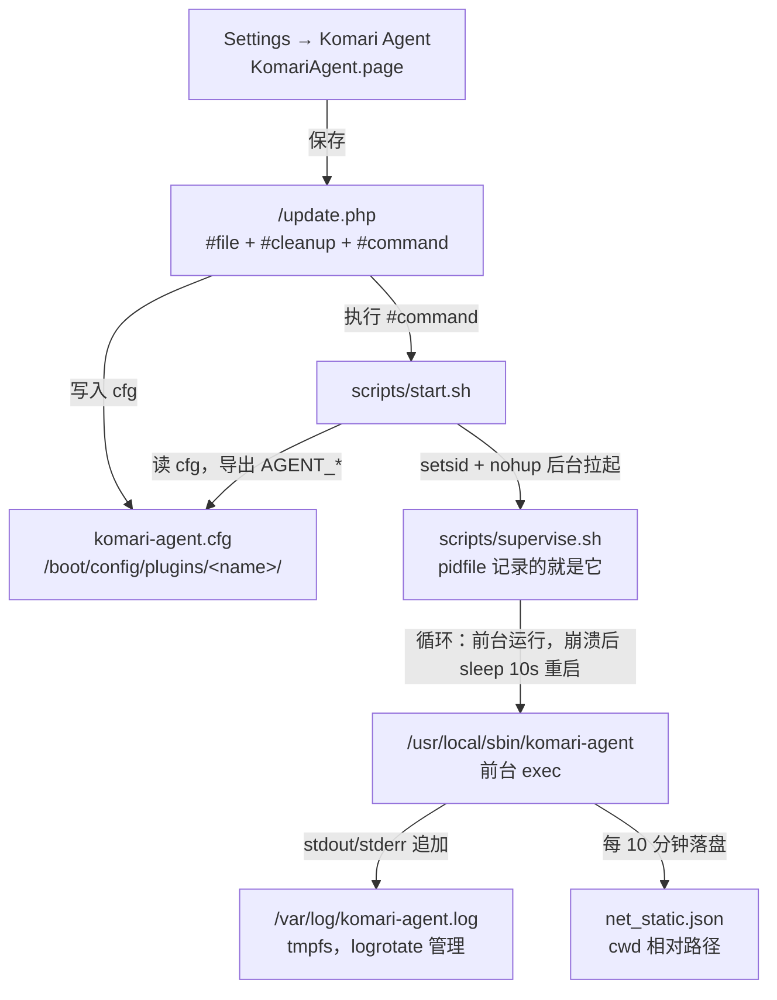
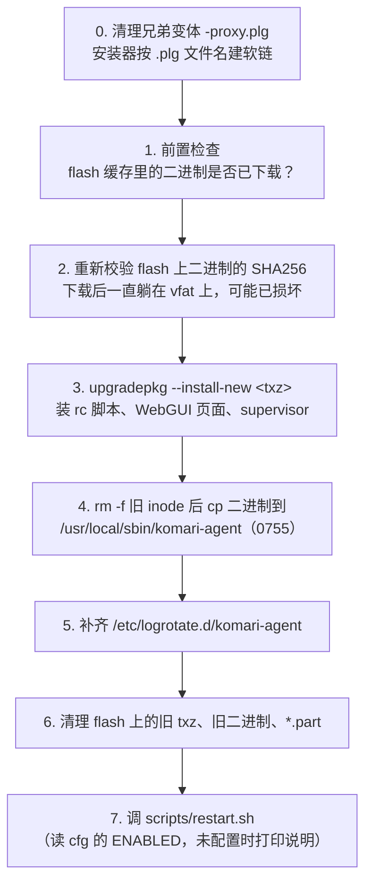
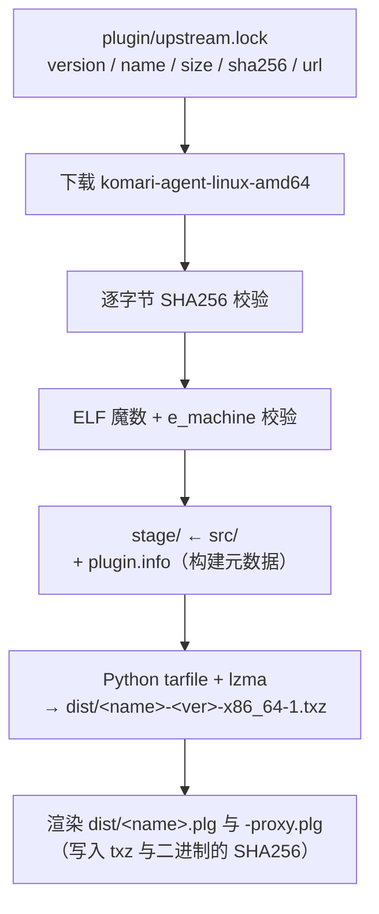

# 技术设计

## 一、Unraid 插件机制速查

| 机制 | 说明 |
|---|---|
| 插件定义 | `*.plg`（XML），放在 `/boot/config/plugins/` |
| 开机执行 | `/etc/rc.d/rc.local` 遍历 `/boot/config/plugins/*.plg`，逐个 `plugin install` |
| 安装器 | `/usr/local/sbin/plugin`（PHP，源码见 `unraid/webgui` → `emhttp/plugins/dynamix.plugin.manager/scripts/plugin`），下载 `<FILE>` → 校验 `<SHA256>` → 执行 `<FILE Run>` |
| 已装标记 | 成功后建软链 `/var/log/plugins/<plg 文件名>.plg → /boot/config/plugins/<plg 文件名>.plg`（按**文件名**建，不是按 `name` 属性） |
| 文件缓存 | `<FILE Name="/boot/config/plugins/<name>/xxx">` 下载后缓存在 flash 上，**已存在的文件不会被覆盖**，所以缓存文件名必须带版本号 |
| 版本比较 | 插件版本之间用 `strcmp()`（按字节比较字符串），不是语义化比较；`min`/`max` 与 Unraid 版本之间才用 `version_compare()` |
| 包管理 | Slackware 原生：`installpkg` / `upgradepkg --install-new` / `removepkg` / `makepkg` |
| 卸载 | `<FILE Run="..." Method="remove">` |

> **每次开机都是全新安装**：`/var/log` 是 tmpfs（`rc.S` 里 `mount -t tmpfs … /var/log`），
> `/usr` 是只读 squashfs + 内存 overlay。两者都不跨重启，所以安装脚本每次都会执行。
> 这也是安装脚本必须幂等、且**绝不能以非零状态退出**的原因：非零退出会让安装器把
> `.plg` 移到 `/boot/config/plugins-error/`，并且不建 `/var/log/plugins` 软链——插件在
> WebGUI 里既不显示、也没有卸载按钮。

### 两个 `.plg`：直连版与代理版

构建产物有两个插件文件，来自同一个模板 `plugin/unraid-plugin-komari-agent.plg.in`：

| 文件 | 下载来源 |
|---|---|
| `unraid-plugin-komari-agent.plg` | GitHub Release 资产，直连 |
| `unraid-plugin-komari-agent-proxy.plg` | 同一资产，经 `https://gh-proxy.org/` 代理 |

两者**只有三处不同**：`pluginURL` 属性、`<URL>` 下载地址、`<CHANGES>` 里的一句来源说明。
插件名、`<FILE Name>` 缓存路径、安装/卸载脚本、SHA256 全部相同，因此装出来的是同一个包。

代理规则就是把 GitHub 链接整体拼到代理前缀后面：

```
https://gh-proxy.org/https://github.com/<owner>/<repo>/releases/download/<tag>/<file>
```

代理返回的是原始字节，所以 SHA256 不变，`verify-release.sh` 对代理版的校验结果与直连版一致。

> 两个文件**只需安装其中一个**。插件名相同，同时放在 `/boot/config/plugins/` 不会冲突，
> 但会让 `/etc/rc.d/rc.local` 在每次开机时把同一个包装两遍。主版安装时会主动删除代理版。

---

## 二、为什么这个插件比参考项目复杂

参考项目 `unraid-plugin-docker-model` 分发的是一个**一次性 CLI 子命令**：拷进
`/usr/libexec/docker/cli-plugins/`，执行完就退出，没有状态、没有进程、没有配置。
本项目分发的是**常驻守护进程**，多出来的每一层都是 Unraid 缺失的基础设施：

| 维度 | docker-model（一次性 CLI） | komari-agent（常驻守护进程） |
|---|---|---|
| 上游产物 | apt deb，需解析 ar 容器 | GitHub Releases 直接给静态二进制 |
| 运行形态 | 执行完即退出 | 常驻，需要 start/stop/重启/崩溃拉起 |
| 系统集成 | 拷一个文件 | rc 脚本 + supervisor + logrotate + pidfile |
| 配置 | 无 | INI 文件 + WebGUI 表单 + `/update.php` |
| 状态 | 无 | 进程状态、uptime、流量统计、日志尾部、面板连通性 |
| 自更新 | 不适用 | 上游自带，本项目**默认关闭**（见第六节） |
| 工作目录 | 无关 | **必须**是 flash 目录（见第五节） |

---

## 三、运行架构



### 进程模型

Unraid 没有 systemd，所以由 `start.sh` 用 `setsid` 拉起一个 supervisor 循环：

```sh
nohup setsid /bin/bash "$PLUGIN_DIR/scripts/supervise.sh" >>"$LOG" 2>&1 &
```

`supervise.sh` 的主体是一个死循环：

```sh
while :; do
  run_agent                 # 前台 exec 二进制，导出 AGENT_* 环境变量
  sleep "$RESTART_DELAY"    # 默认 10 秒
done
```

要点：

- **pidfile 记录的是 supervisor 的 pid**，不是 agent 的 pid。停止时先杀 supervisor，
  再杀它的 agent 子进程——否则 supervisor 会立刻把刚被杀掉的 agent 重新拉起来。
- **`status` 同时报告两个 pid**，因为用户想知道"守护在不在"和"agent 在不在"，这是两个
  不同的问题：守护在、agent 不在，说明 agent 正在崩溃重启循环里。
- **`pgrep --ns` 限定同一 PID 命名空间**。Unraid 上跑着 Docker，容器里的进程名可能
  与 `komari-agent` 相同；不加命名空间限定会误杀/误判。这也是官方 tailscale 插件的做法。
  该选项**不是无条件使用**：`lib.sh` 先用一个探针进程判断本机的 `pgrep` 是否支持
  `--ns`（Unraid 7 带的是 procps-ng，支持；更老的 busybox `pgrep` 不支持），不支持时
  自动退化为不带 `--ns`。判据是探针的退出码：`1` 表示"选项被接受且没有匹配"，
  其它值表示"选项不被理解"。宁可少限定也不能多限定——错误的 `--ns` 会把正在运行的
  agent 藏起来，而不带它最多只是多报几个进程。
- **agent 以 `exec` 前台运行**，这样它的 pid 就是 supervisor 的子进程，信号能正确传递。

---

## 四、安装流程（`.plg` 的 `<FILE Run>`）



**第 2 步为什么值得单独做**：安装器已经校验过下载，但文件随后一直躺在 vfat 上，
直到本次安装才被读取。重新校验能把"U 盘损坏"当场变成一条明确的错误，而不是开机后
一个莫名其妙的崩溃循环。

**第 4 步为什么要先 `rm -f`**：正在运行的二进制不能被覆盖（`Text file busy`）。
先 unlink 旧 inode，正在运行的进程仍持有自己那份副本，拷贝就能成功。

**幂等性**：`upgradepkg --install-new` 对已装同版本是 no-op，`rm -f` 对不存在文件是
no-op，`cp -f` 覆盖同名文件，logrotate 配置仅在缺失时创建，因此开机反复执行安全。

**永远 `exit 0`**：脚本开头 `trap 'exit 0' EXIT`，且每个失败分支都显式 `exit 0`。
原因见第一节。插件保持「已注册」状态，用户才能自己卸载或更新。

**二进制为什么分两步走**：`.plg` 的 `<FILE Name>` 只能把文件下载到 flash（vfat）。
vfat 不能存执行位，也不能可靠地执行程序。所以二进制先落在 flash 当**缓存**，安装脚本
每次把它拷到 `/usr/local/sbin/`（overlay，可执行）并 `chmod 0755`。这就是"重启即丢、
开机重装"的完整闭环。

---

## 五、为什么工作目录必须是 flash 目录

`komari-agent` 把流量统计写到 **`./net_static.json`**——一个相对路径。这个文件决定了
面板上"本月流量"的累计值，必须跨重启保留。

Unraid 上可写的位置只有三个：

| 位置 | 可写 | 跨重启 | 可执行 |
|---|---|---|---|
| `/usr` | overlay | ❌ | ✅ |
| `/var/log` 等 `/var` | tmpfs | ❌ | ✅ |
| `/boot`（flash，vfat） | ✅ | ✅ | ❌ |

只有 flash 同时满足"可写"和"跨重启"。所以 `supervise.sh` 在每次拉起 agent 之前先
`cd` 到

```
/boot/config/plugins/unraid-plugin-komari-agent/
```

若该目录不可进入，则退回 `/var/tmp` 并记一条日志——宁可丢统计也不能让 agent 起不来。

代价是每 10 分钟一次小文件写入（约 100–200 KB）。对一根现代 U 盘来说这个写入量可以
忽略，而丢掉流量统计是用户可见的功能损失。

> 这就是为什么**不能手工直接运行二进制**：手工运行时 cwd 是当前 shell 的目录，
> `net_static.json` 会写到别处（通常是 overlay），重启即丢。所有入口
> （rc 脚本、设置页、安装脚本）都走 `scripts/start.sh`，由它拉起 `supervise.sh`，
> 而 `cd` 在 `supervise.sh` 里——这样每一轮重启都重新落回 flash 目录。

---

## 六、为什么不启用上游自更新

`komari-agent` 默认每 6 小时查 GitHub Releases 并**原地覆盖自己的可执行文件**。
在本插件里这个行为是有害的：

1. `/usr/local/sbin` 在 overlay 上，重启即还原；每次开机 `plugin install` 都会从 flash
   缓存重新拷贝钉死的版本，自更新成果会被回滚 —— 白下载。
2. 自更新会绕过插件的 SHA256 钉死与可复现构建，破坏供应链可验证性。
3. 二进制位置若改为 flash（vfat）则不可执行，自更新必然失败并反复重试。

因此默认 `DISABLE_AUTO_UPDATE=1`，版本升级通过发布新插件完成（构建脚本只改一行 pin）。
页面上的"高级"区域允许用户显式打开，但会给出警告。

---

## 七、配置的写入与读取链路

```
设置页表单
  → POST /update.php
      #file    = unraid-plugin-komari-agent/komari-agent.cfg   （相对 /boot/config/plugins/）
      #cleanup = （空，表示不删除未提交的键）
      #command = /usr/local/emhttp/plugins/unraid-plugin-komari-agent/scripts/restart.sh
  → /update.php 写文件（所有值为双引号字符串）
  → /update.php 执行 #command，输出渲染到进度框
  → restart.sh 输出人类可读进度，重启 agent
```

读取侧（PHP 与 shell 双方）：

- **PHP**：`parse_ini_file($path, false, INI_SCANNER_RAW)`。必须用 `INI_SCANNER_RAW`，
  否则 `~`、`|`、`&` 等字符会被当作运算符求值，整个文件解析失败。
- **shell**：`source` 之前先确保文件存在；缺省键必须回退到默认值，不能假定键一定存在。

**`#cleanup` 为空**是关键：它让 `/update.php` 不删除配置文件里未出现在表单中的键。
如果清空这个字段，任何一次保存都会把高级键（如 `EXTRA_ARGS`）抹掉。

**未在配置表中列出的键不得写入 cfg**：声明了却没人读的配置是"死配置"，用户改了没反应，
是比缺功能更糟的体验。

---

## 八、构建流程（`scripts/build-plugin.sh`）



构建**不访问网络查询元数据**：上游的确切资产（版本、资产名、字节大小、URL、SHA256）
钉在 `plugin/upstream.lock` 里，构建只读这个文件。锁文件由
`scripts/update-upstream.sh` 从 GitHub Releases API 刷新——于是上游升级表现为一处可
审阅的 diff，而不是 CI 期间的隐式变化；构建本身也可复现、可离线。

### 为什么用 Python 的 `tarfile` 而不是 `tar`

打包必须**可复现**：同一「插件版本 + 上游版本」组合在任何机器、任何检出目录都产出相同
的 txz SHA256。shell 调用 `tar` 做不到这一点——不同实现在相同参数下仍会写出不同的字节：

| 字段 | GNU tar（Linux/CI） | bsdtar（macOS） |
|---|---|---|
| `mode` | `"0000755\0"` | `"000755 \0"` |
| `uname` | 真实用户名 | 空 |
| 成员顺序 | `readdir` 顺序 | `readdir` 顺序（与前者不同） |
| 扩展属性 | 不适用 | 写入 `LIBARCHIVE.xattr.*` pax 头 |

改用 Python 的 `tarfile` 后只剩一个实现，且每个头部字段都显式赋值：uid/gid 为 0、
uname/gname 为空、mtime 固定为 2020-01-01、目录与可执行文件 0755 其余 0644、成员按
路径分量排序。跨平台字节一致成为构造性保证，而不是"希望如此"。

CI 用两道校验固定这一点：连续构建两次比对 hash，以及从 `git clone` 出来的新目录再构建
一次比对 hash（排除"依赖检出目录"这一类隐蔽问题）。

### 版本号方案

| 锁定项 | 值 | 原因 |
|---|---|---|
| 插件版本 | `YYYYMMDD`（如 `20261106`） | Unraid 用 `strcmp()` 比较插件版本，发布日期格式能保证字节序与时间序一致；语义化版本会出事（`1.5.10` 排在 `1.5.9` 之前） |
| 同日第二版 | `YYYYMMDD.a`（再往后 `.b`、`.c`） | 同一天多次发布时用字母后缀区分，`20261106 < 20261106.a < 20261106.b < 20261107` |
| 上游版本 | `1.5.11` | 作为 `upstream` 实体与 `plugin.info` 的 `UPSTREAM_VERSION` 单独记录 |
| 架构 | `amd64`（打包为 `x86_64`） | Unraid 只有 x86_64 |

**插件版本与上游版本解耦**：插件版本描述的是「这个插件包」，上游版本描述的是「里面那个
二进制」。同一个上游版本的重新打包（修安装脚本、加 WebGUI 页面）同样要能推给已安装的
用户，所以两者不能绑死。`lint-plg.sh` 会检查这一点：`version == upstream` 直接判失败。

---

## 九、WebGUI 与数据端点

| 文件 | 职责 |
|---|---|
| `KomariAgent.page` | 落地 tab（概览）：`Menu="Settings:99"`、`Type="xmenu"`、`Tabs="true"`，`launch` 指向它。agent 是否在跑、面板是否可达、出问题时最常用的三个按钮 |
| `KomariAgent-1-Settings.page` | 配置表单 |
| `KomariAgent-2-Status.page` | 详情 tab：二进制完整性、流量统计、日志尾部 |
| `include/Pages/Status.php` | 两个状态 tab 共用的视图，由 `.page` 传入 `$komariStatusMode`（`summary` / `detail`）选择模式 |
| `include/common.php` | 常量、cfg 读取、带超时的 `proc_open` 执行器、状态探测、HTML 转义 |
| `include/Pages/Settings.php` | 表单渲染 |
| `include/Pages/Status.php` | 状态页静态部分 |
| `include/data/Status.php` | 返回 JSON：二进制版本、进程状态、uptime、日志尾部、流量摘要、面板连通性 |
| `include/data/Action.php` | 白名单动作端点（`restart` / `stop` / `start` / `clear-traffic`） |

两条硬规则：

1. **不允许在页面渲染期同步跑可能阻塞的命令。** 探测进程、读日志、探面板连通性都可能
   慢（面板不可达时是超时级别），同步执行会把整个 Settings 标签页卡住几十秒。状态数据
   一律走 `$.post` 异步拉取。
2. **动作端点的请求值永不进入 shell。** 动作名走**固定白名单**，命令在服务端定义；
   同时校验同源（Origin/Referer），且只接受 POST。

`Action.php` 在后台启动动作并立即返回 JSON，而不是同步等待。`restart.sh` 要停进程、
等 TERM、必要时 KILL、再拉起，同步执行容易撞上 FastCGI 请求超时。

---

## 十、许可与合规

| 组件 | 许可 | 说明 |
|---|---|---|
| `komari-agent` 二进制 | MIT | 来自 komari-monitor，本插件原样分发，见 `NOTICE` |
| Komari 面板 | MIT | 由用户自行部署，不在本项目分发 |
| 本项目脚本/文档 | MIT | |

`NOTICE` 里记录上游地址、捆绑版本与 SHA256，`.plg` 的 `<CHANGES>` 里注明来源与版本，
`docs/01-design-decisions.md` 记录校验链。
